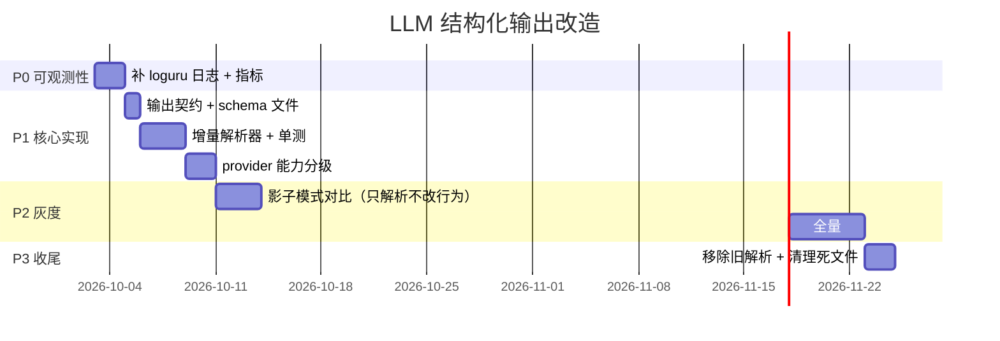

# 设计方案：LLM 结构化输出改造

| 项目 | 内容 |
|---|---|
| **状态** | 待评审 |
| **作者** | — |
| **日期** | 2026-10-02 |
| **影响范围** | `core/connection.py`、`core/utils/textUtils.py`、`core/providers/llm/`、prompt 模板与配置 |
| **关联文档** | [ARCHITECTURE.md](ARCHITECTURE.md)、[SEQUENCE_DIAGRAMS.md](SEQUENCE_DIAGRAMS.md)、[PERF_AUDIO_LATENCY.md](PERF_AUDIO_LATENCY.md) |

---

## 1. 背景

当前项目让 LLM 用**自定义文本标记**同时输出语音文本和机器人动作：

```
[语音回复:你好呀，我是小智][动作指令:WAVE]
```

服务端用正则 `\[语音回复:(.*?)\]` / `\[动作指令:(.*?)\]` 解析
（[core/utils/textUtils.py:28](core/utils/textUtils.py#L28) `parse_robot_response`）。

### 1.1 现状问题清单

| # | 问题 | 证据 | 严重度 |
|---|---|---|---|
| P1 | **格式设计导致性能回归** | 动作码嵌在语音文本内，必须拿到完整输出才能解析 → [connection.py:1031-1036](core/connection.py#L1031-L1036) 整段缓冲 LLM 输出，首音延迟 1s → 4s | 🔴 高 |
| P2 | **规范散落在非版本控制文件里** | 动作码说明写在 `data/.config.yaml` 的 `prompt:` 字段，而 `data/` 被 [.gitignore:42](.gitignore#L42) 忽略 | 🔴 高 |
| P3 | **存在无人引用的"规范文件"** | 根目录 [机器人Agent_prompt](机器人Agent_prompt) 无任何代码引用，改它无效 | 🟡 中 |
| P4 | **约定两处维护** | 动作码在 prompt 里一份、在 `ACTION_CODES` 里一份，漏改即静默降级 | 🟡 中 |
| P5 | **静默失败** | 格式不符 → 降级 `NOACTION`，无日志无告警无指标 | 🟡 中 |
| P6 | **调试点不可见** | [textUtils.py:49-51,79](core/utils/textUtils.py#L49-L51) 用标准库 `logging` 打 INFO，但项目从未调用 `logging.basicConfig`，日志被静默丢弃 | 🟡 中 |
| P7 | **正则边界脆弱** | `.*?` 非贪婪，语音内容含 `]` 即截断；多处 `[语音回复:...]` 只取第一个 | 🟡 中 |

### 1.2 问题根源

**P1 是设计层面的失误，不是编码 bug。** 把两个语义不同的输出（长文本 + 短枚举）压进同一个字符串里，
就必须整体解析，天然无法增量处理：

```
设计：动作码和语音混在一个文本字段
  → 实现：必须等 LLM 全量输出完才能解析
  → 结果：TTS 无法与 LLM 并行，首音延迟与回复长度线性相关
```

---

## 2. 目标与非目标

### 2.1 目标

| 编号 | 目标 | 可量化指标 |
|---|---|---|
| G1 | 格式由**机器保证**，不依赖 prompt 约束 | 格式解析成功率 ≥ 99.9% |
| G2 | 支持**流式增量解析**，语音文本可边生成边送 TTS | 首音延迟与回复长度**解耦** |
| G3 | 规范**进版本控制**，与角色 prompt 解耦 | 换角色不影响功能 |
| G4 | 失败可**观测、可降级**，不静默 | 降级事件 100% 有日志和指标 |
| G5 | 兼容现有全部 LLM provider | 不支持新协议的 provider 自动降级 |

### 2.2 非目标

- ❌ 不改变设备端协议（`{"type":"action",...}` / `{"type":"tts",...}` 保持不变）
- ❌ 不引入新的 LLM 供应商依赖
- ❌ 不改动 TTS、ASR 链路

---

## 3. 方案选型

### 3.1 候选方案

| 方案 | 格式保证 | 流式友好 | 延迟 | provider 兼容性 | 改造成本 |
|---|---|---|---|---|---|
| **A. Tool Calling 双通道**<br/>content=语音 / tool_calls=动作 | 强（API 保证） | 差 | 高 | 中 | 中 |
| **B. JSON Schema 结构化输出** ⭐ | 最强（strict 模式） | **好** | 中 | 中 | 中 |
| **C. 文本标记 + 增量解析** | 弱（靠 prompt） | 最好 | 最低 | **最强** | 低 |
| D. 后置规则/小模型推断动作 | — | — | 高 | 强 | 高 |

### 3.2 为什么不选 A（Tool Calling）

`content` 和 `tool_calls` 是 OpenAI 协议里**两个独立的语义通道**，而我们的需求是
「一次回答同时产出语音和动作」——这天然不匹配：

```
模型决定调工具时，content 通常为空
  → 没有语音文本可播
  → 必须走 Action.REQLLM 分支再请一次 LLM 生成语音
  → 多一次完整往返，延迟翻倍
```

而且现有代码在 tool_call 分支下**不会把 streamed content 推给 TTS**
（[connection.py:1096-1101](core/connection.py#L1096-L1101) 只 `store_tts_text` 后 `clear`），
要支持「边说话边做动作」还得额外改造。

> tool calling 仍是**项目自有工具**（`get_weather`、`play_music` 等）的正确通道，本方案不动它。
> 这里只讨论「动作指令」这一个特殊需求。

### 3.3 为什么不选 D

引入第二个模型或规则引擎，增加部署复杂度和延迟，且动作语义依赖语境，规则覆盖不全。

### 3.4 推荐方案：B（JSON 结构化输出）

**核心思路**：用 JSON Schema 定义输出契约，把 `voice` 放在**第一个字段**、`actions` 放最后，
配合**增量 JSON 解析器**，实现「格式由机器保证」+「语音可流式」两个目标。

```json
{"voice":"哈喽！我是小智，今天想聊点啥呢？","actions":[{"code":"WAVE","delay_ms":0},{"code":"THINK","delay_ms":800}]}
```

上面这个对象里，`voice` 排在 `actions` **前面**——这不是随手写的顺序，是设计的一部分：

| 字段 | 就绪时机 | 服务端动作 |
|---|---|---|
| `voice` | 模型生成到第 8 个字时 | **立刻推给 TTS 队列**，开始合成 |
| `actions` | 模型把整句说完后 | 此时语音已经在播了，再下发动作 |

**对比现状的关键优势**：JSON 字符串有**明确的终结符**（未转义的 `"`），
不像 `[语音回复:` 需要靠 lookahead 猜测标记是否被 token 切半。

> **不保留 C 作为兜底**（决策 D6）：主力 provider 都支持 `json_object`，
> 为边缘模型维护两套解析器不划算。完整响应样例见 §4.1.0。

---

## 4. 详细设计

### 4.1 输出契约

#### 4.1.0 完整响应样例

**用户说**：`你好呀`

**LLM 返回**（完整、无省略）：

```json
{"voice":"哈喽！我是小智，今天想聊点啥呢？","actions":[{"code":"WAVE","delay_ms":0},{"code":"THINK","delay_ms":800}]}
```

格式化后看得更清楚：

```json
{
  "voice": "哈喽！我是小智，今天想聊点啥呢？",
  "actions": [
    {"code": "WAVE",  "delay_ms": 0},
    {"code": "THINK", "delay_ms": 800}
  ]
}
```

**配合这句话的行为**（`delay_ms` 是相对上一条的间隔）：

| 时刻 | 事件 |
|---|---|
| t=0ms | 服务端下发 `WAVE` → 机器人挥手 |
| t=0ms | 同时 TTS 开始播「哈喽！我是小智，今天想聊点啥呢？」 |
| t=800ms | 服务端下发 `THINK` → 机器人转为托腮思考姿势 |

**无动作的场景**（模型判断不需要肢体语言）：

```json
{"voice":"今天广州多云，气温 24 到 30 度，出门带件薄外套就行。","actions":[]}
```

**满动作的场景**（顶到 `maxActions: 3` 上限）：

```json
{"voice":"好耶！那我先鼓掌，再给你敬个礼，最后指向左边的那本书。","actions":[{"code":"CLAP","delay_ms":0},{"code":"SALUTE","delay_ms":1000},{"code":"POINT_LEFT","delay_ms":1200}]}
```

#### 4.1.1 JSON Schema

**运行时由代码生成，不是静态文件**（原因见 §4.1.4）。下面是 `build_reply_schema()` 的**完整展开结果**：

```json
{
  "type": "object",
  "properties": {
    "voice": {
      "type": "string",
      "description": "要朗读的纯口语文本。不要包含任何标记或格式符号。"
    },
    "actions": {
      "type": "array",
      "maxItems": 3,
      "description": "按执行顺序排列的肢体动作，没有合适的动作时空数组 []",
      "items": {
        "type": "object",
        "properties": {
          "code": {
            "type": "string",
            "enum": [
              "CLAP",
              "POINT_LEFT",
              "POINT_RIGHT",
              "SALUTE",
              "THINK",
              "WAVE",
              "WELCOME"
            ],
            "description": "肢体动作代码"
          },
          "delay_ms": {
            "type": "integer",
            "minimum": 0,
            "maximum": 5000,
            "description": "相对上一条动作的延迟毫秒数；第一条通常填 0"
          }
        },
        "required": ["code", "delay_ms"],
        "additionalProperties": false
      }
    }
  },
  "required": ["voice", "actions"],
  "additionalProperties": false
}
```

> **注意 enum 里没有 `NOACTION`**——决策 D6 已移除，无动作统一用空数组表示。
> 上表 enum 是按 `sorted(ACTION_CODES)` 排序后的结果，共 7 项。

#### 4.1.2 流式分片视图

这是本方案的核心机制：**模型逐 token 输出，服务端边收边把 `voice` 推给 TTS**。

下面这张表是 `core/utils/stream_json.py` 的**实际行为**，由
[tests/test_stream_json.py](tests/test_stream_json.py) 的 `test_stream_progressive` 固化：

| # | 到达的 token 分片 | 解析器吐出 | 累计 voice | 说明 |
|---|---|---|---|---|
| 1 | `{"voice"` | — | — | 前缀不完整，缓冲区等待 |
| 2 | `:"哈喽！我` | `哈喽！我` | `哈喽！我` | **前缀补齐，立刻开始下发** |
| 3 | `是小智，今天` | `是小智，今天` | `哈喽！我是小智，今天` | 持续下发 |
| 4 | `想聊点啥呢？"` | `想聊点啥呢？` | `哈喽！我是小智，今天想聊点啥呢？` | 遇到未转义 `"`，voice 结束 |
| 5 | `,"actions":[]}` | — | 同上 | voice 已完成，不再产出 |
| 6 | 流结束 | — | — | `finish()` 解析出 `actions` |

**关键点在第 2 片**：模型才生成到第 5 个字，前 4 个字已经推给 TTS 了。
而 `actions` 要到第 5 片才出现——**提前量约 1 秒**。

对照现状（方括号方案）：必须等**全部分片**收完才能开始解析，
因为事先不知道 `[动作指令:` 会在哪个 token 边界出现。

> **为什么第 2 片就能吐**：JSON 里一旦越过值的开引号，直到下一个**未转义**的 `"`
> 之前都是字符串内容。这个边界是**语法保证**的，不需要猜。
> 方括号方案没有这种保证——`]` 可能出现在语音内容里。

> ⚠️ 真实 token 边界取决于 provider 的 tokenizer，上表是**用于说明机制的代表性切分**，
> 不是实测的 DeepSeek 分片结果。但「能在 `voice` 值的中途就开始下发」这一性质
> 与具体切分无关。

#### 4.1.3 三个关键设计点

1. **字段顺序是设计的一部分**：`voice` 必须在 `actions` 之前，保证流式解析时语音先就绪。
2. **`actions` 是对象数组**：每个动作带独立的 `delay_ms`，支持「挥手 → 停 1 秒 → 鼓掌」。
3. **`maxItems: 3`**：限制单次回复的动作数量，防止模型输出长动作串。
   上限为**代码内固定常量** `MAX_ACTIONS = 3`（决策 D5），不做成配置。

#### 4.1.4 Schema 由代码生成，不用静态文件

**为什么不用 `config/schemas/robot_reply.json`**：动作码既然会扩展，静态文件就意味着
「加一个动作要改 schema 文件 + 改 `ACTION_CODES`」——正是要消灭的 P4（两处维护）。

改为**从单一数据源生成**：

```python
# core/utils/textUtils.py

# 唯一数据源：动作码 → 说明（NOACTION 已移除，见 §4.1.5）
ACTION_DESCRIPTIONS = {
    "WAVE":        "挥手打招呼",
    "CLAP":        "拍手鼓掌",
    "THINK":       "思考动作（手托下巴）",
    "WELCOME":     "欢迎手势（双臂张开）",
    "POINT_LEFT":  "指向左",
    "POINT_RIGHT": "指向右",
    "SALUTE":      "敬礼",
    # ← 新增动作只改这一个地方
}
ACTION_CODES = frozenset(ACTION_DESCRIPTIONS)

# 固定上限（决策 D5：先定死，不做成配置）
MAX_ACTIONS = 3
# 单个动作延迟上限（毫秒），防止模型给出离谱数值
MAX_DELAY_MS = 5000


def build_reply_schema() -> dict:
    """构建 LLM 输出契约。新增动作码后自动生效，无需改第二处。"""
    return {
        "type": "object",
        "properties": {
            "voice": {"type": "string", "description": "要朗读的纯口语文本"},
            "actions": {
                "type": "array",
                "maxItems": MAX_ACTIONS,
                "description": "按执行顺序排列的肢体动作，没有则用空数组",
                "items": {
                    "type": "object",
                    "properties": {
                        "code": {"type": "string", "enum": sorted(ACTION_CODES)},
                        "delay_ms": {
                            "type": "integer",
                            "minimum": 0,
                            "maximum": 5000,
                            "description": "相对上一条动作的延迟毫秒数；第一条通常填 0",
                        },
                    },
                    "required": ["code", "delay_ms"],
                    "additionalProperties": False,
                },
            },
        },
        "required": ["voice", "actions"],
        "additionalProperties": False,
    }


def render_action_spec() -> str:
    """渲染给 LLM 看的动作说明（T2 路径写进 prompt 用）"""
    return "\n".join(f"- {c}: {d}" for c, d in ACTION_DESCRIPTIONS.items())
```

**收益**：新增一个动作码，只改 `ACTION_DESCRIPTIONS` 一处，schema、prompt、校验白名单全部自动同步。

#### 4.1.5 `NOACTION` 已移除

原方案保留 `NOACTION` 仅为兼容 T3 旧路径。**T3 已废弃**（§4.5），所以：

```python
# 内部统一表示：list[dict]，空列表 = 无动作
actions: list[dict]   # [{"code": "WAVE", "delay_ms": 0}, ...]
```

**无动作 = 空数组 `[]`**，不再有 `NOACTION` 这个码。
`ACTION_CODES` 里移除它，schema 的 enum 自然也不含它。

> **迁移注意**：现有 `data/.config.yaml` 的角色 prompt 里有
> `[动作指令:NOACTION]` 的说明和示例，改造时要一并清理（§4.4）。

### 4.2 增量解析器

新增 `core/utils/stream_json.py`，一个**针对固定契约手写的状态机**（无第三方依赖）：

```python
class VoiceStreamExtractor:
    """从流式 JSON 中增量提取 voice 字段。

    契约固定为 {"voice": "...", "actions": [...]}，voice 为首字段，
    因此可以用极简状态机提取，不需要通用 JSON 解析器。
    """

    VOICE_KEY = '{"voice":"'

    def __init__(self):
        self.buf = ""          # 未消费的原始累积
        self.state = "PREFIX"  # PREFIX -> VALUE -> DONE
        self.escape = False

    def feed(self, token: str) -> str:
        """喂入新 token，返回本次可安全送 TTS 的文本（可能为 ""）"""
        if self.state == "DONE":
            self.buf += token
            return ""

        self.buf += token

        if self.state == "PREFIX":
            i = self.buf.find(self.VOICE_KEY)
            if i == -1:
                # 前缀可能被 token 切半，保留尾部等待
                self.buf = self.buf[-len(self.VOICE_KEY):]
                return ""
            self.buf = self.buf[i + len(self.VOICE_KEY):]
            self.state = "VALUE"

        # 状态机提取 JSON 字符串值，处理转义
        out, consumed = [], 0
        for idx, ch in enumerate(self.buf):
            if self.escape:
                out.append(self._unescape(ch))
                self.escape = False
                consumed = idx + 1
            elif ch == "\\":
                self.escape = True
                consumed = idx + 1
            elif ch == '"':
                self.state = "DONE"
                consumed = idx + 1
                break
            else:
                out.append(ch)
                consumed = idx + 1

        self.buf = self.buf[consumed:]
        return "".join(out)

    @staticmethod
    def _unescape(ch: str) -> str:
        return {"n": "\n", "t": "\t", "r": "\r", '"': '"', "\\": "\\", "/": "/"}.get(ch, ch)


class RobotReplyParser:
    """完整解析器：负责 voice 流式提取 + actions 最终解析"""

    MAX_DELAY_MS = 5000

    def __init__(self, valid_actions: frozenset, max_actions: int = 3):
        self.voice = VoiceStreamExtractor()
        self.valid_actions = valid_actions
        self.max_actions = max_actions
        self.raw = ""
        self.voice_text = ""
        self.actions: list[dict] = []     # [{"code":..., "delay_ms":...}]
        self.ok = False

    def feed(self, token: str) -> str:
        self.raw += token
        chunk = self.voice.feed(token)
        self.voice_text += chunk
        return chunk          # 调用方拿到就推 TTS 队列

    def finish(self) -> tuple:
        """流结束，解析 actions 并做校验"""
        try:
            obj = json.loads(self.raw)
            self.voice_text = (obj.get("voice") or "").strip()
            raw_actions = obj.get("actions") or []
            if isinstance(raw_actions, (str, dict)):   # 容错：模型给了单个而非数组
                raw_actions = [raw_actions]
            self.actions = self._normalize(raw_actions)
            self.ok = True
        except (json.JSONDecodeError, AttributeError, TypeError):
            # 降级：整体解析失败，保留增量提取到的 voice 文本，动作为空
            self.ok = False
        return self.voice_text, self.actions

    def _normalize(self, raw_actions: list) -> list:
        """逐项校验：非法码跳过、延迟钳制、数量截断。不因单项非法丢弃全部。"""
        out = []
        for item in raw_actions:
            if len(out) >= self.max_actions:
                metrics.incr("robot_reply.actions_truncated")
                break
            if isinstance(item, str):                 # 容错：模型只给了码
                code, delay = item, 0
            elif isinstance(item, dict):
                code, delay = item.get("code"), item.get("delay_ms", 0)
            else:
                metrics.incr("robot_reply.action_rejected", reason="type")
                continue

            if code not in self.valid_actions:
                metrics.incr("robot_reply.action_rejected", reason="unknown_code")
                continue

            try:                                      # 钳制到 [0, MAX_DELAY_MS]
                delay = max(0, min(int(delay), self.MAX_DELAY_MS))
            except (TypeError, ValueError):
                delay = 0

            out.append({"code": code, "delay_ms": delay})
        return out
```

**容错策略**——逐项处理，不因单项失败丢弃全部：

| 模型实际输出 | 处理结果 |
|---|---|
| `["WAVE", "CLAP"]` | 容错为 `[{WAVE,0}, {CLAP,0}]` |
| `[{"code":"WAVE"}]` | `delay_ms` 缺省补 0 |
| `[{"code":"FLY"}]` | 跳过该项，计 `action_rejected` |
| `delay_ms: 99999` | 钳制到 5000 |
| 4 个以上动作 | 截断到 `max_actions`，计 `actions_truncated` |

**与旧解析器的对比**：

| | 旧（方括号） | 新（JSON） |
|---|---|---|
| 前缀识别 | `[语音回复:` 需 lookahead 防切半 | 同样需 lookahead，但前缀固定无歧义 |
| 值终结 | `]`，但**内容里可能有 `]`** | `"`，**JSON 规范保证内容里的 `"` 必须转义** |
| 边界处理 | 需要 `KEEP` 回退长度 | 状态机自然处理 |
| action 解析 | 正则猜 | `json.loads` 严格解析 |

### 4.3 调用点改造

[core/connection.py](core/connection.py) `chat()` 的流循环：

```python
# 初始化（for response in llm_responses: 之前）
parser = RobotReplyParser(ACTION_CODES)

for response in llm_responses:
    ...
    if content:
        response_message.append(content)
        latency.mark(self, "llm_token")

        # ▼ 新增：边收边提取 voice，立刻推 TTS
        voice_chunk = parser.feed(content)
        if voice_chunk:
            self.tts.tts_text_queue.put(TTSMessageDTO(
                sentence_id=current_sentence_id,
                sentence_type=SentenceType.MIDDLE,
                content_type=ContentType.TEXT,
                content_detail=voice_chunk,
            ))
            if not first_tts_pushed:
                latency.mark(self, "tts_enqueue")
                first_tts_pushed = True

# 流结束后
voice_text, actions = parser.finish()
if not parser.ok:
    metrics.incr("robot_reply.parse_fallback", reason="json_invalid")   # 见 §5
if actions:
    metrics.observe("robot_reply.actions_per_reply", len(actions))
    asyncio.run_coroutine_threadsafe(
        schedule_actions(self, current_sentence_id, actions), self.loop
    )

self.dialogue.put(Message(role="assistant", content=voice_text))
self.tts.store_tts_text(current_sentence_id, voice_text)
```

**不需要改 `_get_segment_text()`**——它本来就是为增量喂入设计的，
会对入队文本做缓冲 + 标点切句。这次改造只是把 token 重新喂回去。

#### 4.3.1 动作下发：服务端调度

**动作之间的时间间隔由服务端控制**，不需要改设备协议：

```python
async def schedule_actions(conn, sentence_id, actions: list[dict]):
    """按 delay_ms 依次下发动作。服务端异步调度，设备端只负责执行。"""
    task = asyncio.current_task()
    conn._action_tasks[sentence_id] = task      # 供 abort 时取消
    try:
        for act in actions:
            delay = act["delay_ms"]
            # 第一条的 delay 相对本响应下发时刻，其余相对上一条，语义一致
            if delay > 0:
                await asyncio.sleep(delay / 1000.0)

            if conn.client_abort or conn.sentence_id != sentence_id:
                metrics.incr("robot_reply.action_seq_aborted")
                return                              # 被打断，终止后续动作
            await send_action_message(conn, act["code"])
    finally:
        conn._action_tasks.pop(sentence_id, None)
```

> `conn._action_tasks` 需在 `ConnectionHandler.__init__` 里初始化为 `{}`，
> 并在 `handleAbortMessage()` 中取消当前句子的任务。

**设备协议不变**，仍是单动作消息。两个动作 = **两条独立消息**，按顺序下发：

```jsonc
// 第 1 条（t=0ms）
{"type": "action", "action": "WAVE", "session_id": "abc123"}
// 第 2 条（t=800ms）
{"type": "action", "action": "CLAP", "session_id": "abc123"}
```

#### 为什么选服务端调度

**决策 D9**：固件本期不做改动，时序全部由服务端控制。

| | **服务端调度**（本方案） | 设备端调度 |
|---|---|---|
| 固件改动 | ✅ **零改动** | ❌ 需发新固件 |
| 上线速度 | 立即 | 等固件发版周期 |
| 打断响应 | ✅ 复用现有 `client_abort` | 需额外取消协议 |

**已知取舍**：服务端 `sleep` 期间若连接断开，动作序列会中断。
考虑到语音对话本身也是同一连接，连接断开时对话已经结束，这个取舍可接受。

> **后续演进**：若将来固件希望自行掌控时序（如按动作实际时长动态调整），
> 可在消息里**追加** `delay_ms` 字段（additive，老固件忽略即可）。
> 当前设计不阻塞这条路。

### 4.4 规范落地位置

动作码的**代码侧**单一数据源见 §4.1.1（`ACTION_DESCRIPTIONS`）。

**prompt 侧**同步改造：把动作规范从 `data/.config.yaml` 的 `prompt:` 字段
**移到** `agent-base-prompt.txt` 模板的 `<robot_action>` 段落，用占位符引用：

```
<robot_action>
你可以做以下肢体动作：
{{action_spec}}

输出格式要求：
- voice 字段：要朗读的纯口语文本
- actions 字段：按执行顺序排列的动作数组，没有合适的动作用 []
</robot_action>
```

`{{action_spec}}` 由 `render_action_spec()` 渲染。**收益**：

| | 现状 | 改造后 |
|---|---|---|
| 规范位置 | `data/.config.yaml`（**被 gitignore**） | `agent-base-prompt.txt`（**进版本控制**） |
| 换角色 | 动作功能消失 | 不受影响，规范在模板层 |
| 加动作码 | 改 prompt + 改代码白名单 | 只改 `ACTION_DESCRIPTIONS` |

### 4.5 Provider 支持

**前提（决策 D8）**：后期只使用支持 JSON 输出的提供商（DeepSeek 等 OpenAI 兼容协议）。
因此**不需要复杂的多级降级设计**，只保留两种模式：

| 模式 | 条件 | 请求方式 | 格式由谁保证 | 校验 |
|---|---|---|---|---|
| **json_object**（默认） | 支持 `response_format: {type:"json_object"}` | schema 写进 prompt | 只保证"是合法 JSON" | 应用层 `json.loads` + 逐字段校验 |
| **json_schema**（可选） | 额外支持 `strict: true` | 传完整 schema | **厂商 API 强制** | provider 保证 |

**默认用 `json_object`**——它是主流 OpenAI 兼容协议的通用能力，覆盖面最广；
`json_schema` 作为可选升级项，实测确认支持后再开。

#### 不支持时的行为

配置了不支持的 provider 时：

```
动作功能关闭 → 退化为纯语音助手（语音完全正常）
```

**不做方括号回退**（决策 D6）。因为主力 provider 都支持 `json_object`，
覆盖不到的场景只剩边缘模型，为此维护两套解析器不划算。

必须配套：
1. **启动时打印警告**，明确说明当前 provider 不支持动作功能
2. `robot_reply.action_disabled` 指标
3. 文档列出各 provider 的支持情况

#### 配置

只保留两个开关，tier 映射不需要：

```yaml
# config.yaml
structured_output:
  enabled: true          # 总开关，可一键回滚（关闭后动作功能整体停用）
  mode: json_object      # json_object（默认）| json_schema（需额外支持 strict）
```

> `max_actions` / `max_delay_ms` **不在配置里**，是代码内固定常量（决策 D5）。
> schema 由 `build_reply_schema()` 从 `ACTION_CODES` 生成（§4.1.1）。

#### 降级链

```
json_schema 请求失败(400/不支持) → 降级 json_object → 再失败 → 动作功能关闭
每级降级都 metric.incr + logger.warning
```

> **关键保证**：结构化输出改造**任何时候都不会导致"说不出话"**。
> 所有失败路径的终点都是「纯文本语音回复 + 无动作」。

### 4.6 校验与重试

```python
def validate_reply(obj: dict) -> tuple[bool, list[str]]:
    errors = []
    if not isinstance(obj.get("voice"), str) or not obj["voice"].strip():
        errors.append("voice 缺失或为空")
    if obj.get("action") not in ACTION_CODES:
        errors.append(f"action 非法: {obj.get('action')!r}")
    if set(obj.keys()) - {"voice", "action"}:
        errors.append(f"存在未定义字段: {set(obj) - {'voice','action'}}")
    return (not errors), errors
```

**重试策略**：校验失败时**不重试**，直接降级。理由：
语音对话对延迟敏感，重试一次至少 +1s，用户体感更差。
把 `voice` 原文送去 TTS（用户能听到回答）比重新生成更合理。

> 如果后续发现有场景必须重试，再加 `max_retry: 1` 配置，默认关闭。

### 4.7 失败降级行为

| 失败点 | 行为 | 用户感知 |
|---|---|---|
| T1 请求报错 | 降级到 T2 | 无（自动） |
| T2 也失败 | **动作功能关闭**，只输出语音 | 能正常对话，机器人不做动作 |
| 流式解析中途失败 | 保留已提取的 voice，继续读完 | 无 |
| `finish()` 整体解析失败 | 用增量提取到的 voice 文本；actions=`[]` | 能听到回答，无动作 |
| `actions` 含非法码 | 逐项跳过，保留合法项 | 非法动作不执行，其余正常 |
| `actions` 是字符串/对象而非数组 | 包装成单元素数组 | 无（容错） |
| `delay_ms` 超范围 | 钳制到 `[0, max_delay_ms]` | 延迟被限制，动作仍执行 |
| 动作数超 `max_actions` | 截断，计 `actions_truncated` | 执行前 N 个 |
| 动作序列执行中途被打断 | 取消后续动作（`client_abort` / 换句） | 动作停在当前位置 |
| voice 为空 | 用原始 LLM 输出直送 TTS（剥掉 JSON 外壳） | 可能听到 JSON 残片，但有兜底 |

> **贯穿所有失败路径的保证**：语音永远能播出来。最坏情况只是**没有肢体动作**。

---

## 5. 可观测性

配套 P3 已落地的 `core/utils/latency.py`，新增以下指标：

| 指标 | 类型 | 标签 | 用途 |
|---|---|---|---|
| `robot_reply.parse_total` | Counter | `tier`, `provider` | 总解析次数 |
| `robot_reply.parse_ok` | Counter | `tier`, `provider` | 成功次数，观测各 provider 表现 |
| `robot_reply.parse_fallback` | Counter | `reason` | 降级次数（`request_failed` / `json_invalid` / `field_missing`） |
| `robot_reply.action_disabled` | Counter | `provider` | **动作功能被关闭的次数**（T3 路径） |
| `robot_reply.action_dist` | Counter | `code` | 各动作码出现次数 |
| `robot_reply.actions_per_reply` | Histogram | — | 每次回复的动作数量，观测多动作使用率 |
| `robot_reply.action_rejected` | Counter | `reason` | 非法动作码被拒（`unknown_code` / `type`） |
| `robot_reply.actions_truncated` | Counter | — | 超过 `max_actions` 被截断 |
| `robot_reply.action_seq_aborted` | Counter | — | 动作序列执行中途被打断 |
| `latency.tts_enqueue` | Histogram | — | 入 TTS 队列耗时（验证 G2） |

**告警规则**：
- `parse_fallback / parse_total > 1%` 持续 5 分钟 → 告警
- **`action_disabled > 0`** → 提示当前 provider 不支持结构化输出，动作功能已关闭
- `action_rejected` 突增 → prompt/schema 与模型行为脱节
- `action_seq_aborted` 占比过高 → 动作延迟设置过长，用户常在动作播完前打断
- `actions_per_reply` p99 异常增大（如 > 8）→ 模型可能陷入动作重复

日志全部改用 **loguru**（`logger.bind(tag=TAG)`），与项目其他模块一致。
**移除** [textUtils.py](core/utils/textUtils.py) 里那 4 条标准库 `logger.info`（当前等于死代码）。

---

## 6. 实施计划

### 阶段划分



### 逐阶段说明

| 阶段 | 交付物 | 验收 |
|---|---|---|
| **P0 可观测性** | loguru 日志、7 个指标（§5） | 能在日志/指标里看到当前解析成功率 |
| **P1 核心实现** | `core/utils/stream_json.py`、`build_reply_schema()`、provider tier 逻辑 | 单测覆盖：正常/切半/转义/空/多动作/非法码/字符串容错/畸形 JSON |
| **P2 灰度** | 影子模式 + 灰度开关 | 影子模式下新旧解析结果一致率 ≥ 99.5% |
| **P3 收尾** | 删除 `parse_robot_response`、`机器人Agent_prompt` | 全量后观察 3 天无降级尖峰 |

### 影子模式（关键设计）

**上线前先跑影子模式**：新解析器与旧解析器**同时运行**，只用旧的结果驱动业务，
新的结果只做记录和比对。

```
LLM 输出
  ├─→ 旧解析器 → 驱动 TTS/动作（不变）
  └─→ 新解析器 → 只记录，比对两者差异 → 打点
```

这样能在**零风险**下验证新解析器的正确性和格式遵从率。差异率低于阈值才进灰度。

---

## 7. 风险与应对

| 风险 | 概率 | 影响 | 应对 |
|---|---|---|---|
| ~~模型在 JSON 模式下首 token 变慢~~ | — | — | ✅ **已排除**：2026-10-02 实测 `json_object` 中位 422ms vs baseline 891ms，**无劣化**。详见 §10.4.1 |
| 部分 provider 不支持 `json_schema` | 高 | 只能用 T2，或完全无动作 | 能力分级已覆盖；T2 只需 prompt + `json_object` |
| 主力 provider 实测都不支持结构化输出 | 低 | **动作功能全线不可用** | 上线前先完成遗留事项 #1（能力矩阵实测），确认主力 provider 可用再进入灰度 |
| 模型在 voice 字段里塞入 JSON 转义字符 | 低 | 解析出错 | 状态机已处理转义；单测覆盖 |
| 改 prompt 后模型行为漂移 | 中 | 回答质量变化 | 灰度对比；保留旧 prompt 可回滚 |
| 增量解析推送的碎片影响 TTS 断句 | 中 | 语音不自然 | `_get_segment_text()` 已有标点切句逻辑，验证即可 |

---

## 8. 验收标准

| 指标 | 基线（当前） | 目标 | 测量方式 |
|---|---|---|---|
| 格式解析成功率 | **未知**（无指标） | ≥ 99.9% | `parse_ok / parse_total` |
| 首音延迟 p50 | 4.0s | **≤ 1.5s** | `[LATENCY]` 打点 |
| 首音延迟与回复长度相关性 | 强相关 | **无关** | 按 TTS 句数分桶对比 |
| 降级率 | 未知 | ≤ 0.1% | `parse_fallback / parse_total` |
| 非法动作码被拒率 | 未知 | ≤ 0.1% | `action_rejected / parse_total` |
| 多动作使用率 | — | 观测即可，无硬指标 | `actions_per_reply` 分布 |

> 「基线未知」本身就是 P5 的体现——当前系统**无法回答"格式遵从率是多少"这个问题**。
> 所以 P0 可观测性必须最先做。

> ⚠️ **首音延迟目标 ≤ 1.5s 需要实测验证**。JSON 模式会比纯文本多输出约 20-30 token，
> 且部分 provider 在 JSON 模式下首 token 更慢。影子模式阶段要对比实测，
> 若劣化超过 200ms 需要重新评估（见 §7 风险表）。

---

## 9. 回滚方案

| 层级 | 回滚手段 | 生效时间 | 影响 |
|---|---|---|---|
| 一级 | `structured_output.enabled: false` | 重启后立即 | 动作功能整体停用，语音正常 |
| 二级 | `mode: json_schema` → `json_object` | 重启后立即 | 仅降级格式保证强度 |
| 三级 | `git revert` 对应 commit | 重新部署 | 完整回滚 |
| 数据 | 旧解析器在 P3 前**保留在代码库** | — | 可临时切回旧路径 |

**保证**：P3 完成前，`parse_robot_response` 始终保留在代码库中，
即使新方案出问题也能快速切回。

> ⚠️ 注意：因为旧路径也依赖方括号 prompt，回滚时**prompt 也要一起回滚**。
> 建议把 prompt 改动和代码改动放在**同一个 commit**，避免回滚时漏掉。

---

## 10. 附录

### 10.1 与现状的对照

| | 现状 | 改造后 |
|---|---|---|
| 输出格式 | `[语音回复:...][动作指令:...]` | `{"voice":"...","actions":["WAVE","CLAP"]}` |
| 动作数量 | 单动作 | **数组，支持多个** |
| 格式保证 | prompt 措辞"绝对不允许偏差" | JSON Schema（T1 由 API 强制） |
| 动作码来源 | prompt 手写 + 代码常量，两处 | `ACTION_DESCRIPTIONS` 单一来源，schema 与 prompt 均由它生成 |
| 规范位置 | `data/.config.yaml`（gitignore） | `agent-base-prompt.txt`（进版本控制） |
| 设备协议 | `{"type":"action","action":"WAVE"}` | **不变**（多动作拆多条消息） |
| 解析方式 | 正则，整体解析 | 状态机，增量解析 |
| 流式能力 | ❌ 必须等全文 | ✅ 边生成边送 TTS |
| 失败处理 | 静默降级 | 分级降级 + 指标 + 告警 |
| 可观测性 | 无 | 5 个指标 + loguru 日志 |

### 10.2 决策记录

| # | 问题 | 决策 | 日期 | 对设计的影响 |
|---|---|---|---|---|
| D1 | 是否接受 JSON 模式的额外 token 开销（约 20-30 token/次）？ | ✅ **接受** | 2026-10-02 | 按方案 B 实施 |
| D2 | 是否需要支持多动作？ | ✅ **需要** | 2026-10-02 | 契约改为 `actions` 数组 |
| D3 | 动作码是否会扩展？ | ✅ **会扩展** | 2026-10-02 | schema **由代码生成**（§4.1.1） |
| D4 | 动作之间是否需要时间间隔？ | ✅ **需要** | 2026-10-02 | 契约加 `delay_ms`；**服务端调度**下发（§4.3.1） |
| D5 | 动作数量上限？ | ✅ **用固定数值 3** | 2026-10-02 | 代码常量 `MAX_ACTIONS = 3`，不做成配置 |
| D6 | 旧方括号方案（T3 兜底）是否保留？ | ✅ **不保留，废弃** | 2026-10-02 | T3 改为「动作功能关闭」；`parse_robot_response` 可删除；`NOACTION` 移除 |
| D7 | 是否需要动作与语音时间对齐？ | ✅ **暂不做** | 2026-10-02 | 保持一次性下发；契约预留演进空间 |
| D8 | 是否兼容所有 LLM provider？ | ✅ **否，只保证支持 JSON 的** | 2026-10-02 | 默认 `json_object` 模式；不做多级 tier 映射（§4.5） |
| D9 | 时序由谁控制？ | ✅ **服务端，固件不改** | 2026-10-02 | 服务端 `asyncio.sleep` 调度（§4.3.1） |
| D10 | 动作执行时长是否反馈给服务端？ | ✅ **不反馈** | 2026-10-02 | 用固定延迟，不做设备回执 |

#### D6 的影响（需明确记录）

放弃 T3 意味着：**换成不支持结构化输出的 LLM，动作功能会关闭**（语音正常，只是没有肢体动作）。

| 受影响场景 | 行为 |
|---|---|
| DeepSeek / Doubao / ChatGLM / Gemini | 正常，支持 T1/T2 |
| 老版 Ollama / LMStudio / 自建模型 | **动作功能关闭**，语音正常 |

配套措施：启动时打印警告、`action_disabled` 指标、文档列出 provider 能力矩阵（§4.5）。

#### D7 的演进空间

当前不做对齐，但如果将来要做，契约演进路径是：

```json
{"voice": "...", "actions": [{"code":"WAVE","delay_ms":0,"at_char":0}]}
```

`at_char` 表示语音文本的第几个字符时触发。现在是**纯增量**改动，
不影响本期设计。

### 10.3 遗留事项

| # | 事项 | 负责方 | 说明 |
|---|---|---|---|
| ~~1~~ | ~~DeepSeek 的 `json_object` 支持需实测确认~~ | 后端 | ✅ **已完成**（2026-10-02）：`json_object` 3/3 成功且 3/3 符合契约。详见 §10.4.1 |
| 2 | `MAX_DELAY_MS = 5000` 的合理取值 | 产品 | 需结合机器人动作实际时长验证（当前无设备回执，只能靠固定延迟） |
| 3 | 动作延迟与语音时长的配合 | 产品 | 现在动作与语音不对齐（D7），延迟值需要人工调优才能让动作看起来自然 |

> **已关闭的遗留事项**：固件改动（D9 确认不做）、设备回执（D10 确认不做）、
> provider 能力矩阵（D8 确认只保证 JSON 提供商，不需要全量矩阵）。

#### 上线前必须完成的前置验证

**遗留事项 #1 是硬前置**——必须先确认 DeepSeek 实际支持 `response_format: json_object`。
**已于 2026-10-02 完成，结果见 §10.4.1。**

### 10.4 前置验证

#### 10.4.1 实测结果（2026-10-02）

**环境**：`deepseek-chat` @ `https://api.deepseek.com`，每模式 3 轮
**脚本**：[performance_tester/verify_structured_output.py](performance_tester/verify_structured_output.py)

```
| 模式          | 请求成功 | 符合契约 | 首token中位 |
|--------------|---------|---------|------------|
| baseline     | 3/3     | 3/3     | 891 ms     |
| json_object  | 3/3     | 3/3     | 422 ms     |
| json_schema  | 0/3     | —       | —          |
```

**三条结论**：

**① `json_object` 完全可用** —— 请求 3/3 成功（不报 400），输出 3/3 符合契约。
`mode: json_object` 作为默认值得到验证，**设计前提成立**。

**② `json_schema` 不支持** —— 返回 400：

```
"This response_format type is unavailable now"
```

DeepSeek 没有实现 strict structured outputs。**确认走 `json_object` + 应用层校验**（§4.2）。
这意味着格式的最终保证靠「prompt 约束 + 解析器容错」，而不是 API 强制——
§4.6 的逐项校验和 §4.7 的降级链因此更重要。

**③ 首 token 延迟无劣化** —— 实测 `json_object` 比 baseline **快 469ms**。

> ⚠️ **这个对比不完全公平**，样本量小（各 3 次）且两个模式生成的文本长度不同：
> baseline 的回复更长（无 JSON 结构约束，模型话更多），
> 如 `'你好呀！我是小智，很高兴见到你～有什么我...'`。
> **可靠结论是「JSON 模式没有引入延迟惩罚」**，而不是「JSON 模式更快」。
> §7 风险表的头号风险（JSON 导致首 token 变慢）**已排除**。

**④ 附带验证：多动作生效** —— 第 2 轮输出了两个动作：

```json
{"voice":"12 乘 8 等于 96，这个简单！","actions":[{"code":"THINK",...},{"code":"CLAP",...}]}
```

**⑤ 附带发现：模型会自发遵循格式** —— baseline 模式（不带 `response_format`）
的输出同样能被解析出 `voice` / `actions`。说明 system prompt 里的格式说明已经足够清晰，
`response_format` 是**额外的保险**而非必需。这对理解 §4.6 的校验策略有参考价值：
真正的格式保证来自 prompt 措辞，`json_object` 只保证「是合法 JSON」。

#### 10.4.2 复现方式

```bash
python performance_tester/verify_structured_output.py --runs 3
```

脚本会从 `data/.config.yaml` 读取 provider 配置，无需手动填 key。
验证其它 provider 时用 `--provider <配置名>`。

**验证要点**（脚本自动检查）：

| 检查项 | 通过标准 |
|---|---|
| `response_format` 是否被接受 | 不报 400 |
| 输出是否为合法 JSON | `json.loads` 成功 |
| 是否遵循 prompt 里的字段结构 | 含 `voice` 和 `actions`，动作码合法 |
| 首 token 延迟对比 | 相对 baseline 劣化 < 200ms |

### 10.5 参考资料

- [OpenAI Structured Outputs](https://platform.openai.com/docs/guides/structured-outputs)
- 项目内已有的 function calling 实现：[core/providers/tools/unified_tool_handler.py](core/providers/tools/unified_tool_handler.py)
- 性能分析：[PERF_AUDIO_LATENCY.md](PERF_AUDIO_LATENCY.md)
