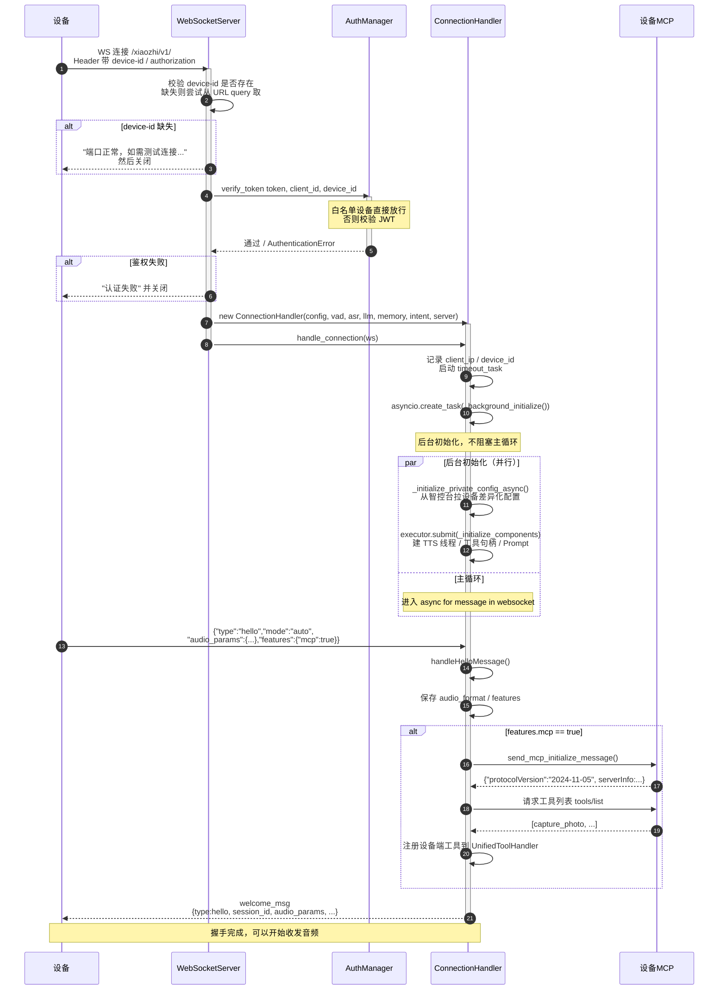
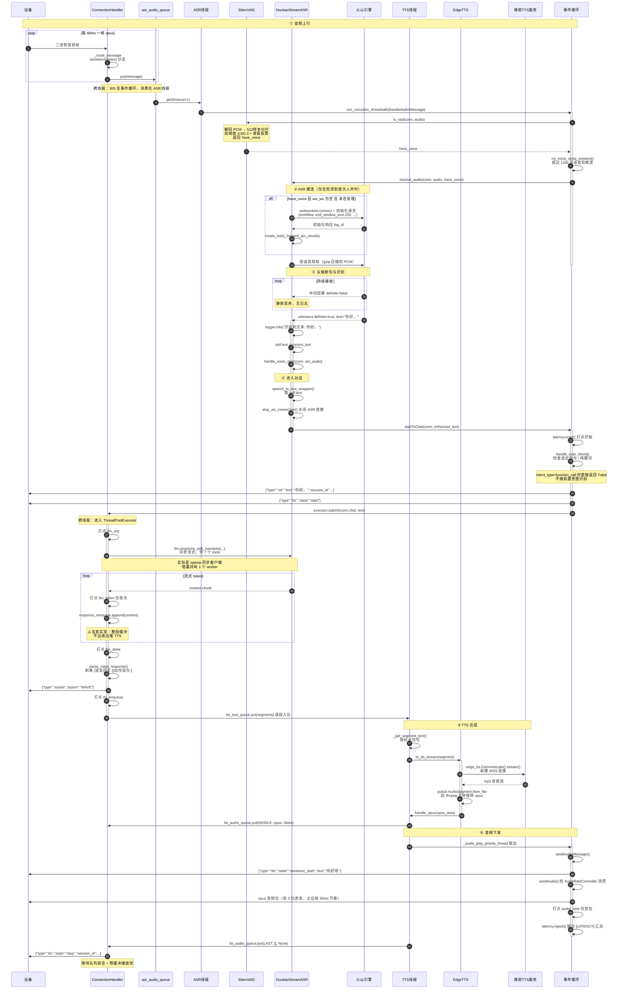
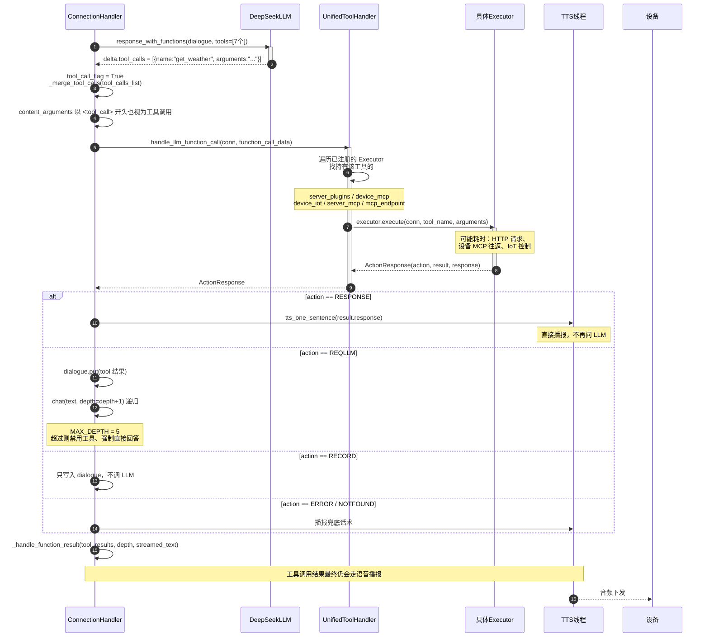
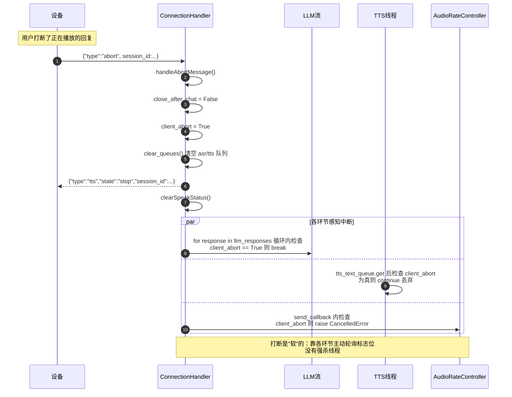
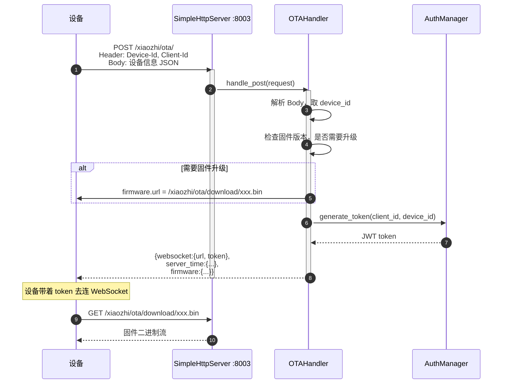
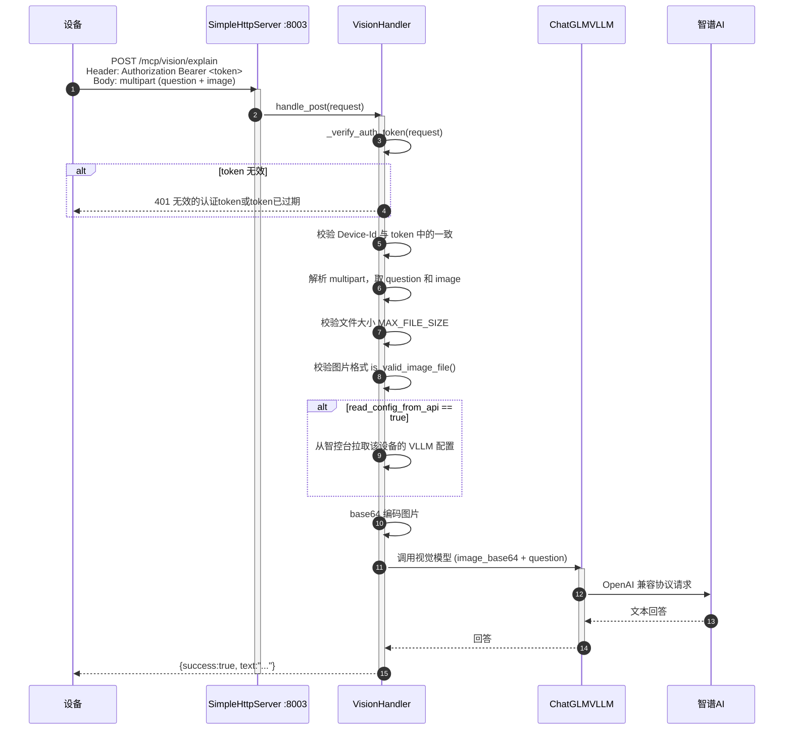
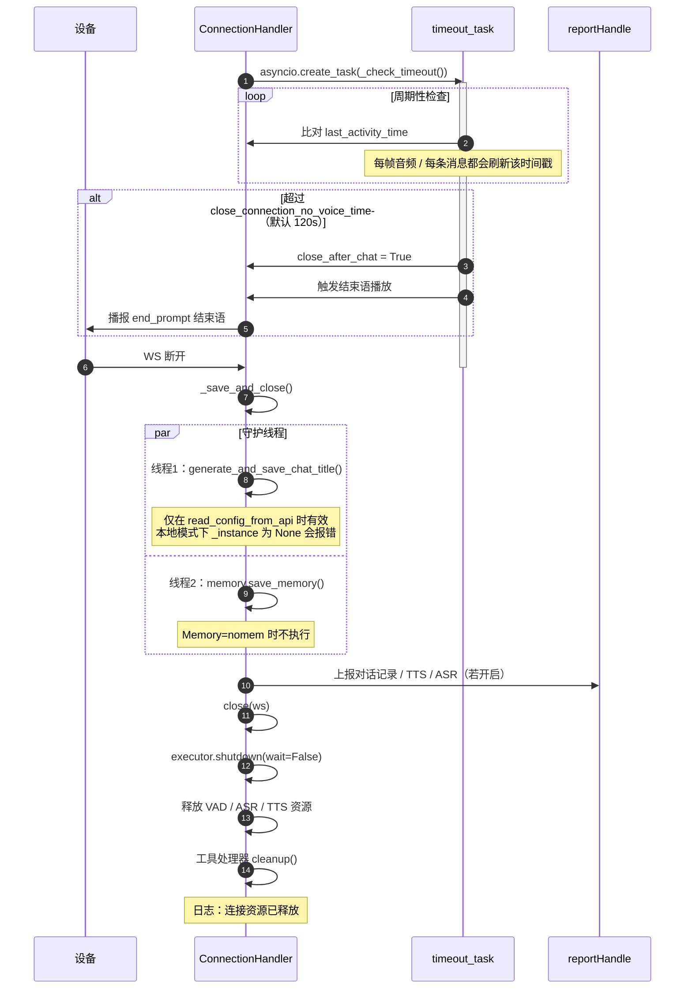
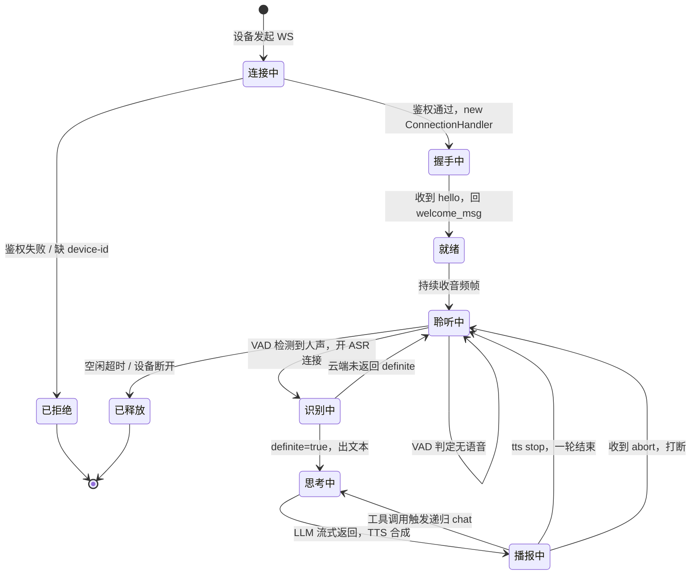

# xiaozhi-server 业务时序图

> 本文用 Mermaid 时序图描述后端各条业务链路的实际调用顺序。
> 所有调用点都标注了源文件，便于对照代码。
>
> 配套阅读：[ARCHITECTURE.md](ARCHITECTURE.md)（分层与目录职责）、[PERF_AUDIO_LATENCY.md](PERF_AUDIO_LATENCY.md)（延迟分析）

---

## 0. 参与者总览

| 参与者 | 代码位置 | 说明 |
|---|---|---|
| **设备** | — | ESP32 硬件 / Android App / Web 测试页 |
| **WS** | [core/websocket_server.py](core/websocket_server.py) | WebSocket 服务，端口 8000 |
| **HTTP** | [core/http_server.py](core/http_server.py) | aiohttp 服务，端口 8003 |
| **Conn** | [core/connection.py](core/connection.py) | `ConnectionHandler`，每设备一个实例 |
| **VAD** | [core/providers/vad/silero.py](core/providers/vad/silero.py) | 本地 ONNX，CPU 推理 |
| **ASR** | [core/providers/asr/doubao_stream.py](core/providers/asr/doubao_stream.py) | 火山流式识别 |
| **LLM** | [core/providers/llm/openai/openai.py](core/providers/llm/openai/openai.py) | DeepSeek 等，同步流式客户端 |
| **TTS** | [core/providers/tts/](core/providers/tts/) | EdgeTTS / 火山 / Linkerai 等 |
| **Tools** | [core/providers/tools/unified_tool_handler.py](core/providers/tools/unified_tool_handler.py) | 工具聚合与分发 |
| **云端** | — | 火山 / DeepSeek / 微软 等第三方服务 |

### 线程边界（读图关键）

```
主事件循环（asyncio）
  ├─ WS 收发、HTTP 服务
  └─ 各连接的协程任务

每个 ConnectionHandler 额外持有
  ├─ asr_text_priority_thread   ← 线程，消费 asr_audio_queue
  ├─ tts_text_priority_thread   ← 线程，消费 tts_text_queue
  ├─ _audio_play_priority_thread← 线程，消费 tts_audio_queue
  └─ ThreadPoolExecutor(5)      ← 线程池，跑 chat / 工具调用 / 上报
```

图中用 `Note over` 标出跨越的线程边界。**跨线程一律走 `run_coroutine_threadsafe` 或 `executor.submit`。**

---

## 1. 设备接入与握手



> **注意**：`_background_initialize()` 是 fire-and-forget 的。设备可能在组件初始化完成前就发了音频，
> `_route_message` 里会用 `bind_completed_event` 等待最多 1 秒（[connection.py:314-326](core/connection.py#L314-L326)）。

---

## 2. 完整语音对话（自动模式）

这是最核心的链路。以 `SileroVAD + DoubaoStreamASR + DeepSeekLLM + EdgeTTS` 为例。



### 关键点

| 位置 | 说明 |
|---|---|
| **VAD 只决定何时开 ASR 长连接** | 本地 VAD 的 `client_voice_stop` 对流式 ASR 是死代码，判定权在火山云端 |
| **`definite: true` 才算说完** | 中间结果被静默丢弃，代码里连 debug 日志都没有 |
| **`chat()` 跑在 executor 线程** | 同步阻塞，持有 `ThreadPoolExecutor(5)` 的一个 worker |
| **TTS 前先缓冲全文** | `chat()` 把整个回复收完才分段入队，这是首音延迟的主要来源之一 |
| **音频下发有独立流控** | `AudioRateController` 按 60ms/帧精确控制，前 5 包直发降延迟 |

---

## 3. 工具调用（function_call）

当 LLM 返回 `tool_calls` 时走这条支线，会**递归再请求一次 LLM**。



### 关键点

- **工具执行有超时**：`tool_call_timeout` 默认 30 秒（[connection.py:1111](core/connection.py#L1111)）
- **支持并行工具调用**：`tool_calls_list` 收集多个，逐个 `future.result()` 等待
- **递归深度上限 5**：`chat(depth+1)`，到顶后追加系统提示强制直接回答
- **调试提示**：日志里看到多次「大模型收到用户消息」是正常的，说明发生了递归

---

## 4. 打断（Abort）

设备在 TTS 播放期间检测到用户说话时发送。



> ⚠️ **打断不是强杀**。`client_abort` 是个标志位，LLM 流、TTS 线程、音频发送各自检查。
> 如果某个环节正阻塞在 IO 上（比如 LLM 的同步流式读取），要等它自己走到检查点才会停。

---

## 5. HTTP：设备 OTA

设备上电后先调 OTA 拿 WebSocket 地址。



> OTA 接口**只在 `read_config_from_api: false` 时注册**（[http_server.py:45](core/http_server.py#L45)）。
> 用了智控台的话，OTA 由智控台提供。

---

## 6. HTTP：视觉分析

设备拍完照后把图片 POST 过来。



---

## 7. 空闲超时与连接释放



---

## 8. 完整状态机速查

把上面几条链路串起来，一次会话的生命周期：



---

## 附录：一次对话的关键日志对照

按上面 §2 的顺序，日志会依次出现（`grep` 关键字可用于排查）：

| 阶段 | 日志关键字 | 来源 |
|---|---|---|
| ASR 建连 | `正在连接ASR服务` | `core.providers.asr.doubao_stream` |
| ASR 就绪 | `收到初始化响应` | 同上 |
| 识别完成 | `识别到文本: xxx` | 同上 |
| 进入对话 | `大模型收到用户消息: xxx` | `core.connection` |
| 首段音频 | `发送第一段语音: xxx` | `core.handle.sendAudioHandle` |
| 音频下发 | `发送音频消息: SentenceType.FIRST` | 同上 |
| TTS 完成 | `语音生成成功: xxx，重试0次` | `core.providers.tts.base` |
| 延迟汇总 | `[LATENCY] ...` | `core.utils.latency` |
| 一轮结束 | `发送音频消息: SentenceType.LAST` | `core.handle.sendAudioHandle` |
| 连接释放 | `连接资源已释放` | `core.connection` |

> `[LATENCY]` 行需要先启用毫秒日志，见 [PERF_AUDIO_LATENCY.md §4 P3](PERF_AUDIO_LATENCY.md)。
